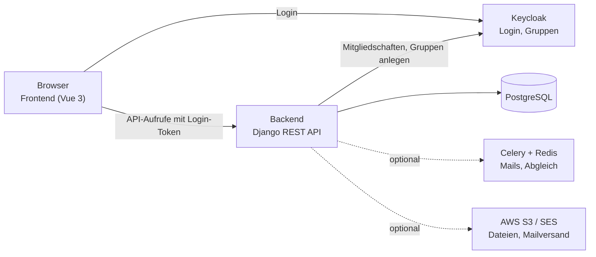
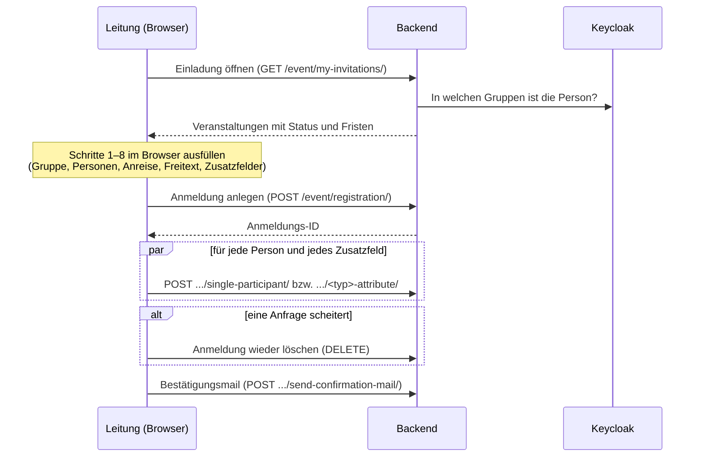

# Architektur

Wie das Scout-Tool aufgebaut ist und wie eine Anmeldung durch das System läuft. Begriffe: `glossar.md`. Gründe für Entscheidungen: `entscheidungen.md`.

## Überblick

- **Frontend** (`frontend/`): Vue 3 mit Vite und Tailwind. Läuft im Browser und spricht nur mit Backend und Keycloak.
- **Backend** (`backend/`): Django 5.2 mit Django REST Framework. Prüft alle Rechte und Fristen und speichert alles in PostgreSQL.
- **Keycloak**: der gemeinsame Login-Server des Verbands. Das Tool fragt ihn nach Login und Gruppenmitgliedschaften. Rechte verwaltet das Tool selbst.
- **Celery/Redis** (optional): Hintergrundaufgaben wie Mails und der regelmäßige Abgleich mit Keycloak. Ohne Celery laufen Aufgaben direkt im Webprozess.

## Backend-Module

| Ordner | Aufgabe | Stand |
| --- | --- | --- |
| `anmelde_tool/event/` | Veranstaltungen, Bausteine, Buchungsoptionen, Fristen (`deadlines.py`), Rechte für Veranstaltungen (`permissions.py`) | aktiv weiterentwickelt |
| `anmelde_tool/event/summary/` | Auswertungen, Statistik, Kasse | aktiv |
| `anmelde_tool/registration/` | Anmeldungen und Teilnehmende | aktiv |
| `anmelde_tool/attributes/` | Zusatzfelder und Antworten | aktiv |
| `anmelde_tool/email_services/` | Bestätigungs- und Erinnerungsmails | aktiv |
| `authentication/` | Konten, persönliche Daten, Registrierung, Beitrittsanfragen, Abgleich mit Keycloak | aktiv |
| `keycloak_auth/` | Gruppen, **Gruppenrechte** (`access.py`), Keycloak-Anbindung | aktiv |
| `basic/` | Stammdaten: Pfadfinderstruktur, Postleitzahlen, Auswahllisten | aktiv |
| `messaging/` | Kontaktformular und Anfragen | eingefroren |
| `notifications/` | Benachrichtigungen (übernommenes Paket, siehe README dort) | eingefroren |
| `food/`, `inspi/` | Essensplanung, Programmideen | abgeschaltet: keine Adressen, Tabellen und Code bleiben, Verwaltungsseiten unter `/admin/` nur für Staff (seit 15.10.2026) |
| `backend/` | Einstellungen, URLs, Celery | aktiv |
| `tests/` | Tests, siehe `CONTRIBUTING.md` | aktiv |

„Eingefroren“ heißt: läuft weiter, wird aber vorerst nicht weiterentwickelt. „Abgeschaltet“ heißt: Die Adressen sind entfernt, im Frontend gibt es keine Menüpunkte mehr. Code und Datenbanktabellen bleiben, und die Essensauswertung einer Veranstaltung nutzt weiter Rechencode aus `food`.

## Rechteprüfung

Jede Anfrage durchläuft drei Stufen:

1. **Login:** Ohne gültiges Login-Token gibt es überall 401, außer bei ausdrücklich öffentlichen Endpunkten (Registrierung, Auswahllisten, Kontaktformular).
2. **Recht auf das Objekt:**
   - Veranstaltungen: `anmelde_tool/event/permissions.py`. Veranstaltungsleitung = `responsible_persons` oder Mitglied der `admin_group`.
   - Anmeldungen: Die anmeldende Leitung oder die Veranstaltungsleitung.
   - Gruppen: `keycloak_auth/access.py`, über die Tabelle `GroupPermission`.
3. **Fristen** (nur bei Änderungen): `anmelde_tool/event/deadlines.py`. Die Veranstaltungsleitung ist ausgenommen.

## Ablauf einer Anmeldung

**Bekannte Schwächen dieses Ablaufs**, siehe `qualitaet.md`:
- Das Absenden besteht aus vielen einzelnen Anfragen statt einer. Scheitert eine, bleibt im ungünstigen Fall eine halbe Anmeldung zurück.
- Die Oberfläche zeigt bei jedem Fehler eine allgemeine Meldung statt der Meldung des Backends.
- Bis zum Absenden liegen alle Eingaben im Speicher des Browsers, auch Daten von Kindern.

## Wo finde ich …

| Thema | Datei |
| --- | --- |
| Fristregeln | `backend/anmelde_tool/event/deadlines.py` |
| Welche Seite welche Schnittstelle aufruft | `docs/schnittstellen.md` (erzeugt) |
| Rechte auf Veranstaltungen und Anmeldungen | `backend/anmelde_tool/event/permissions.py` |
| Rechte auf Gruppen | `backend/keycloak_auth/access.py` |
| Abgleich der Pfadfinderstruktur mit Keycloak | `backend/basic/helper/initialize_keycloak_scout_hierarchies.py`, `sync_keycloak_groups.py` |
| Login und Übernahme von Kontodaten aus Keycloak | `backend/backend/OIDCAuthentication.py` |
| Persönliche Daten speichern, Weitergabe an Keycloak | `backend/authentication/views.py` (`PersonalData`), `authentication/signals.py` |
| Anmeldeablauf im Frontend | `frontend/src/modules/event/views/newRegister/`, `frontend/src/modules/event/store/register.ts` |
| Einstellungen | `backend/backend/settings.py`, Vorlage `dev/backend.env.example` |
| Lokale Umgebung | `dev/`, `README.md` |
